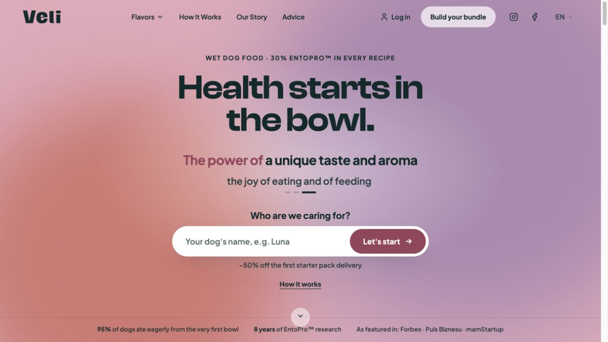

# OpenLup

**Subscription-first, open-source commerce for physical products.**

Build recurring orders, payments and delivery cycles into your TypeScript
application. Your application owns its brand, catalogue, policies and
integrations; OpenLup supplies reusable commerce engines and contracts.

Shaped by real subscription-commerce work at [Velipet](https://velipet.com/)
and designed for development with AI agents, OpenLup combines explicit domain
boundaries, typed ports and executable contract checks.

[Reader guide](packages/core/docs/guide/README.md) ·
[Start here](packages/core/docs/guide/start/README.md) ·
[Apache-2.0](LICENSE)

## Status: development preview

> **Development preview.** OpenLup has published npm packages and bounded local
> evaluation profiles. It does not yet offer a stable framework API, a supported
> full-platform installation or an upgrade guarantee. Source availability and a
> successful build do not establish production readiness.

## Shaped by a real business

OpenLup's development is grounded in [Velipet](https://velipet.com/), a D2C
physical-product subscription business. Its commerce workflows have been
developed and exercised against that real use case, including the practical
relationship between recurring orders, customer choices and physical deliveries.
Those requirements shape the reusable platform contracts and regression tests.

Velipet also exercises the full first-party adoption loop: changes go through
OpenLup's admission and review process, packages are published through the release
process, and the application adopts the published packages. This is dogfooding
across the delivery lifecycle, with feedback from application use returning to
the platform.

Velipet is first-party operating experience. It is not independent-adopter
certification, and it does not mean every extracted npm module or public
reference profile reproduces the complete Velipet application. Velipet retains
its own brand, catalog, policies and provider composition.

[](https://velipet.com/en)

*Velipet's English storefront. Application-specific branding and content;
not the generic OpenLup reference profile.*


## The gap OpenLup addresses
Moved to [Subscriptions](packages/core/docs/guide/concepts/subscriptions.md).

## Is OpenLup for you?

Read the [overview](packages/core/docs/guide/start/README.md) for application ownership, package choices and next steps.

## Why OpenLup
Moved to [Subscription delivery alignment](packages/core/docs/guide/concepts/subscriptions.md#subscription-delivery-alignment).

## Choose an evaluation path

Compare the [evaluation boundaries](packages/core/docs/guide/reference/limits.md#evaluation-boundaries) before selecting packages, the starter or a source reference.

### Use OpenLup in your application

From your application's root, using Node 24 and npm 11.19.0, look up the published package-set version:

```sh
npm view @openlup/core version
```

Replace `<version>` with that exact value:

```sh
npm install --save-exact @openlup/core@<version>
```

Use the same exact version for every `@openlup/*` package you install. See
[installation and application instructions](packages/core/docs/guide/start/README.md#install-the-packages).

### A small example

Calculate renewal-payment retry times with an application-supplied policy:

```ts
import { nextRetryAttemptAt } from "@openlup/core/subscription";

const failedAt = "2026-01-10T09:00:00.000Z";
const cadence = { backoffHours: [24, 72] };

nextRetryAttemptAt(failedAt, 1, cadence); // "2026-01-11T09:00:00.000Z"
nextRetryAttemptAt(failedAt, 2, cadence); // "2026-01-13T09:00:00.000Z"
nextRetryAttemptAt(failedAt, 3, cadence); // null: the retry budget is exhausted
```

This calculates a time; it does not schedule work, persist state or charge.
Continue with the [example explanation](packages/core/docs/guide/start/tutorial.md#calculate-a-retry-time)
and the [database tutorial](packages/core/docs/guide/start/tutorial.md).

### Evaluate the source reference
Moved to [Evaluation boundaries](packages/core/docs/guide/reference/limits.md#evaluation-boundaries).

## Packages and architecture

| Package | Responsibility | Export maturity |
| --- | --- | --- |
| [`@openlup/core`](packages/core/README.md) | Commerce contracts and pure engines | [Core table](packages/core/docs/guide/start/README.md#openlupcore) |
| [`@openlup/outbox`](packages/outbox/README.md) | Transactional enqueue and dispatch | [Outbox table](packages/core/docs/guide/start/README.md#openlupoutbox) |
| [`@openlup/platform`](packages/platform/README.md) | Server infrastructure and optional commerce services | [Platform table](packages/core/docs/guide/start/README.md#openlupplatform) |

Read [architecture and ownership](packages/core/docs/guide/concepts/architecture-and-ownership.md)
for package composition and application boundaries.

The reference UI uses React, Vite and Tailwind CSS; Core does not require that
frontend stack. Browser-shareable contracts stay separate from server execution.
Provider SDKs, environment readers and payload translation belong behind adapters.
Portable PostgreSQL and managed Supabase retain distinct installation histories.

## What is already in the repository
Moved to [Platform source map](docs/platform/SOURCE_MAP.md).

## Current limits and direction

The `P1-SF` gate requires a versioned release and bill of materials, a thin
adopter application, public extension/conformance contracts, upgrade tools and
installation, compatibility, provenance and independent-adopter evidence.

Native account snapshot composition requires explicit saved-address, billing,
preference, event and private-profile sources. Missing sections and newsletter
grants without evaluator evidence refuse `host_binding_required`. Historical
order detail without captured money refuses `native_account_order_money_unavailable`;
summary and line readers retain recorded money. Paid activation gaps are keyed
by order, without inventing a subscription association.

Root `ui-*` neutrality counts remain shrink-only reference-source debt; copying
root pages takes on that debt. Neutral starter and deployment examples are
constrained to system fonts only.

Read [current limits](packages/core/docs/guide/reference/limits.md) and [versioning and stability](packages/core/docs/guide/reference/stability.md).

## Designed for development with AI agents

Start with your application's instructions and the [installed-version guide](packages/core/docs/guide/README.md#instructions-for-agents); platform contributors start with [AGENTS.md](AGENTS.md).

## Source checkout verification

From the selected immutable checkout, use its recorded Node/npm toolchain:

```sh
npm ci
npm run pretest
npm run oss:published-tree -- --policy
npm run oss:published-tree -- --inventory
npm run oss:published-tree -- --typecheck
npm test
npm run build
```

These commands build the default static reference. The default source reference admits GET/HEAD catalogue/item and health reads;
checkout, subscriptions, admin, API/BFF, cron and mutations refuse. The opt-in
subscription reference covers one recurring product with captured payment,
confirmed email sign-in, owned order/subscription reads and renewal-date change.
Automatic renewal, fulfillment, failed-renewal recovery and the complete
late-delivery journey remain outside that profile.
Database tests require Docker
and owned disposable services; the opt-in subscription reference additionally
requires the Supabase CLI. Follow [test scope and diagnostics](CONTRIBUTING.md#test-scope-and-diagnostics)
for execution and interpretation, and the [guide's evaluation boundaries](packages/core/docs/guide/reference/limits.md#evaluation-boundaries)
for reader setup.

## Source preview integrity

The public tree exposes its [policy registry](config/openlup-policy-registry.json),
[publication catalogue](config/openlup-publication-catalog.json) and
[source-release contract](config/openlup-source-release-contract.json).
These machine-readable inputs let a checkout validate its declared source and
policy boundaries. They are not a release receipt or a support promise.
The [publication completeness policy](.github/PUBLICATION_COMPLETENESS.md)
explains their evidence boundary; the source checks above validate the selected
revision without copying moving gap counts into this page.


## Documentation and contribution

- [Reader guide](packages/core/docs/guide/README.md), [glossary](packages/core/docs/guide/glossary.md) and [upgrades](packages/core/docs/guide/upgrade/README.md).
- [Contributing](CONTRIBUTING.md), [maintainer documentation](docs/platform/README.md) and [source map](docs/platform/SOURCE_MAP.md).
- [Releases](https://github.com/openlup/openlup/releases) and [issue reports](https://github.com/openlup/openlup/issues).
- [Security reporting](SECURITY.md), [governance](.github/GOVERNANCE.md) and [Code of Conduct](CODE_OF_CONDUCT.md).

## Follow OpenLup
Moved to [Documentation and contribution](README.md#documentation-and-contribution).

## License and openness

OpenLup is licensed under [Apache License 2.0](LICENSE). See the [tier policy](.github/TIER_POLICY.md) for the open-core commitment.
