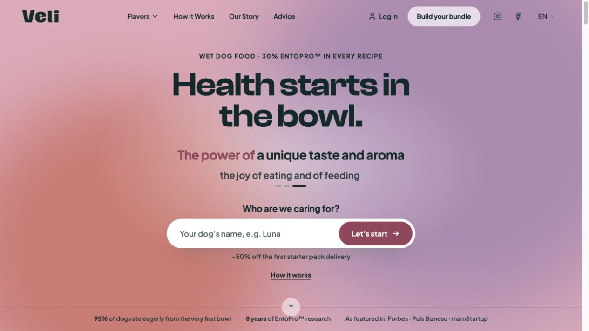

# OpenLup

**Subscription-first, open-source commerce for D2C brands and physical products.**

[Development preview](#current-limits-and-direction) ·
[Apache-2.0](LICENSE) · TypeScript · Node 24

Make repeat purchases a foundation of your commerce application. Build around
recurring orders, payments and the physical delivery cycle. OpenLup brings together subscription engines, catalog and bundle
logic, checkout, customer self-service, inventory, fulfillment and communications
in a TypeScript platform monorepo.

Shaped by real subscription-commerce work at [Velipet](https://velipet.com/)
and designed for development with AI agents, OpenLup combines explicit domain
boundaries, typed ports and executable contract checks.

Your application owns the brand, storefront experience, catalog, local business
rules and integrations. OpenLup owns the reusable engines and platform contracts.

[Explore the documentation](docs/platform/README.md) ·
[Evaluate subscriptions locally](docs/platform/SUBSCRIPTION_REFERENCE.md) ·
[Use the packages](#use-openlup-in-your-application) ·
[For agents](#designed-for-development-with-ai-agents) ·
[Follow progress](#follow-openlup)

## Status: development preview

> **Development preview.** OpenLup has published npm packages and bounded local
> evaluation profiles. It does not yet offer a stable framework API, a supported
> full-platform installation or an upgrade guarantee. Source availability and a
> successful build do not establish production readiness.

## Is OpenLup for you?

OpenLup is for TypeScript developers and commerce teams building recurring
physical-product businesses: replenishment, curated boxes or repeat-order
services. Evaluate it if you want to own the application experience and compose
subscription logic with your own policies and providers.

Today, that means being comfortable with preview APIs and explicit integration
work. Teams needing a supported, ready-to-launch store should first read the
[installation limits](.github/INSTALL_SUPPORT_POLICY.md).

**Start with your goal:**

- **See the buyer journey:** follow the [local subscription walkthrough](docs/platform/SUBSCRIPTION_REFERENCE.md) — purchase → captured email sign-in → account → renewal-date change.
- **Explore the engine:** try the [small code example](#a-small-example) and inspect the [subscription contract](packages/core/docs/SUBSCRIPTION_ENGINE.md).
- **Build an application:** start with the [adopter kit](docs/platform/adopter-kit/README.md) and [package installation](#use-openlup-in-your-application).
- **Contribute to the platform:** read [CONTRIBUTING.md](CONTRIBUTING.md) and find the owner in the [source map](docs/platform/SOURCE_MAP.md).

## The gap OpenLup addresses

Recurring commerce is often delivered through an app or extension — familiar
examples include [Shopify subscription apps](https://www.shopify.com/subscriptions)
and [WooCommerce Subscriptions](https://woocommerce.com/products/woocommerce-subscriptions/).
OpenLup puts the subscription lifecycle at the center of the commerce platform:
pricing, stock, orders, customer self-service and delivery all participate in it.

For D2C brands facing expensive customer acquisition and pressure to grow
customer lifetime value (LTV), repeat purchases are a compelling business goal.
Subscriptions can turn replenishment into an ongoing customer relationship,
provided the product, service and delivery experience earn that repeat purchase.
They are an opportunity to improve retention, not a guaranteed growth result.

SaaS has established recurring-billing tools. Physical-product subscriptions
also need inventory, reservations, parcel evidence and a delivery-aware renewal
cycle. OpenLup focuses on that operational layer for D2C commerce, bringing
those concerns together with recurring payments in an open TypeScript platform.

## Shaped by a real business

OpenLup's development is grounded in [Velipet](https://velipet.com/), a D2C
physical-product subscription business. Its commerce workflows have been
developed and exercised against that real use case, including the practical
relationship between recurring orders, customer choices and physical deliveries.
Those requirements shape the reusable platform contracts and regression tests.

Velipet also exercises the full first-party adoption loop: changes go through
OpenLup's admission and review process, packages are published through the release
process, and the application adopts the published packages. This is dogfooding
across the delivery lifecycle, with feedback from application use returning to
the platform.

Velipet is first-party operating experience. It is not independent-adopter
certification, and it does not mean every extracted npm module or public
reference profile reproduces the complete Velipet application. Velipet retains
its own brand, catalog, policies and provider composition.

[](https://velipet.com/en)

*Velipet's English storefront. Application-specific branding and content;
not the generic OpenLup reference profile.*

## Why OpenLup

Recurring commerce connects more than a payment schedule. A renewal needs the
right price, available stock, permission to charge and evidence about the last
delivery. A failed payment needs a recovery path; a repeated callback must not
create another order or charge.

OpenLup makes those boundaries explicit:

- **Subscription logic you can inspect.** Lifecycle transitions, retries and
  cycle calculations live in a framework-independent engine with an explicit clock.
- **Delivery-aware cycles.** Late delivery may extend the next cycle; it must
  never move it earlier or stack deliveries while an outstanding parcel remains.
- **No mandatory commerce vendor.** Apache-2.0 source, application-owned
  composition and provider-neutral ports let you choose integrations and retain
  control of your application. Payment, shipping, identity, storage and
  communications sit behind adapters.
- **Durable work and replay boundaries.** Transactional outbox, job leases,
  idempotency and ordered migrations support work that survives retries.
- **Application ownership.** Keep business policy and presentation in your own
  application while consuming versioned platform packages.

See the [subscription workflows](docs/platform/SUBSCRIPTION_WORKFLOWS.md) for
implementation paths, invariants and the tests that challenge them.

## Choose an evaluation path

| Path | What you can evaluate | Boundary |
| --- | --- | --- |
| npm packages | Compose selected engines and platform entries in your application | Exact version pins; experimental surfaces; your own adapters and host composition. |
| Default source reference | Static catalog/item pages and health route | GET/HEAD only; checkout, subscriptions, admin, API/BFF, cron and mutations are refused. |
| Opt-in subscription reference | One recurring product, captured payment, confirmed email sign-in, own order/subscription and renewal-date change | Disposable local Supabase + Node; synthetic data, captured mailbox and no external provider calls. |

Automatic renewals, fulfillment, failed-renewal recovery and a complete
late-delivery journey are outside the opt-in profile's current acceptance scope,
even where their services exist in source. A renewal date is a planned charge
date, not a delivery promise.

### Use OpenLup in your application

No platform clone is required. From your application's root, with Node 24 and
npm 11.19.0, first look up the published set version:

```sh
npm view @openlup/core version
```

Replace `<version>` below with that exact value:

```sh
npm install --save-exact @openlup/core@<version>
```

Install additional `@openlup/*` packages only as needed, at the **same exact set
version**. Verify that the selected release contains the exports you intend to
use; source on `main` may be ahead of npm. Read the installed
`node_modules/@openlup/core/AGENTS.md`, its typed wiring example and the package
changelogs before composing or upgrading.

Follow the [adopter kit](docs/platform/adopter-kit/README.md). Your application
owns its instructions, configuration, provider selection and deployment.

### A small example

After installing Core, compute a renewal-payment retry time through its public
subscription export:

```ts
import { nextRetryAttemptAt } from "@openlup/core/subscription";

const failedAt = "2026-01-10T09:00:00.000Z";
const cadence = { backoffHours: [24, 72] };

nextRetryAttemptAt(failedAt, 1, cadence); // "2026-01-11T09:00:00.000Z"
nextRetryAttemptAt(failedAt, 2, cadence); // "2026-01-13T09:00:00.000Z"
nextRetryAttemptAt(failedAt, 3, cadence); // null: the retry budget is exhausted
```

This pure function calculates a time; it does not schedule a job, persist state
or charge a payment method. Your application supplies its retry policy. The
[engine contract](packages/core/docs/SUBSCRIPTION_ENGINE.md) explains lifecycle
and payment rules; the [typed wiring example](packages/core/AGENTS.md#wiring-example)
shows host composition.

### Evaluate the source reference

Select an immutable tag from [Releases](https://github.com/openlup/openlup/releases),
then follow that revision's README and release notes. Current `main` can include
unreleased work; older previews may have different commands and profiles.

From the selected checkout's root, using its recorded Node/npm versions:

```sh
npm ci
npm run pretest
npm run oss:published-tree -- --policy
npm run oss:published-tree -- --inventory
npm run oss:published-tree -- --typecheck
npm test
npm run build
```

These commands check source and build the default static reference; they do not
start a complete commerce application. Some tests require Docker and owned
disposable databases. See [test scope and diagnostics](CONTRIBUTING.md#test-scope-and-diagnostics)
for prerequisites and how to interpret missing proof.

For the buyer/account journey, follow the
[disposable subscription reference](docs/platform/SUBSCRIPTION_REFERENCE.md).
It requires Docker and the Supabase CLI, creates an owned local installation,
and documents setup, server startup, captured mail, HTTP/browser verification
and persistence checks after restart. Use synthetic details; the captured
payment adapter never charges money.

## What is already in the repository

The table describes implemented source, not a list of features enabled in every
profile or included in every npm package. Package extraction and integration
coverage are still progressing; follow each owner for its exact boundary.

| Area | Existing capabilities | Start here |
| --- | --- | --- |
| Subscriptions | Lifecycle, pause/resume, cycle scheduling, renewal orchestration, failed-payment recovery and delivery-alignment protection | [Workflows](docs/platform/SUBSCRIPTION_WORKFLOWS.md) |
| Catalog and bundles | Product/SKU contracts, catalog reads and drafts, media, bundle selection and composition | [Catalog](src/domains/catalog/README.md) · [Bundles](src/domains/bundle/README.md) |
| Pricing and promotions | Price authority, quotes, offer projection, promotion eligibility and acceptance | [Pricing](src/domains/pricing/README.md) · [Promotions](src/domains/promo/README.md) |
| Checkout and orders | Checkout orchestration, order contracts and initial subscription activation | [Commerce](src/domains/commerce/README.md) |
| Payments | Neutral payment contracts, prepared attempts and reference execution/reconciliation adapters; durable money-truth extraction remains in progress | [Payment](src/domains/payment/README.md) · [Current extraction](docs/platform/plans/oss-m07-payments-money-truth.md) |
| Inventory and delivery | Stock ledger, available-to-promise, reservations, demand forecasting, shipping and fulfillment contracts; package parity remains incomplete | [Inventory](src/domains/inventory/README.md) · [Shipping](src/domains/shipping/README.md) · [Fulfillment](src/domains/fulfillment/README.md) |
| Identity and accounts | Customer sign-in, sessions, account linking, operator authorization and privacy export/erasure contracts | [Identity](docs/platform/IDENTITY.md) · [Browser account](docs/platform/IDENTITY_BROWSER_REFERENCE.md) |
| Communications | Email rendering, consent/preferences, newsletter sync, delivery receipts and transactional dispatch | [Communications](src/domains/communications/README.md) · [Outbox](packages/outbox/README.md) |
| Accounting | Invoice/document contracts, issue and correction orchestration, provider synchronization and delivery evidence | [Accounting](src/domains/accounting/README.md) |
| Runtime and data | Node HTTP host, BFF dispatch, scheduling, job leases, blob adapters, data gateways and PostgreSQL migration runner | [Platform package](packages/platform/README.md) |
| Reference application | React storefront/account surfaces, operator source and two bounded evaluation profiles | [Runtime boundaries](docs/platform/RUNTIME_AND_SELF_HOSTING.md) |

The [source map](docs/platform/SOURCE_MAP.md) covers the complete domain and
responsibility inventory, including risk, support, partners and observability.

## Packages and architecture

Three packages form the current workspace and publishable release set:

| Package | Responsibility |
| --- | --- |
| [`@openlup/core`](packages/core/README.md) | Framework-independent TypeScript commerce kernels, shared contracts and readiness/conformance primitives. |
| [`@openlup/outbox`](packages/outbox/README.md) | Transactional enqueue, at-least-once dispatch, leases and retention/compaction. The application supplies effect handlers and their idempotency. |
| [`@openlup/platform`](packages/platform/README.md) | Server infrastructure and experimental module entries for identity, communications, catalog, pricing, promotions, inventory, shipping and payments. |

The platform uses separated domains and a modular **ports-and-adapters**
structure, following hexagonal architecture principles: commerce engines and
use cases depend on explicit contracts, while adapters translate external
systems. This describes the architectural direction and concrete seams; some
reference handlers still carry HTTP types and provider-specific composition.

There is no mandatory hosted OpenLup service or single payment/provider stack.
Changing a provider still requires a compatible adapter, capability checks and
any necessary data or payment-method migration. Provider portability is an
integration boundary, not a promise of effortless switching.

Browser-shareable contracts stay separate from server execution. Provider SDKs,
environment readers and payload translation sit behind adapters. PostgreSQL
migrations own durable changes; the portable PostgreSQL and managed Supabase
schema lanes have distinct installation histories.

The reference uses React, Vite and Tailwind CSS. The reusable Core engines do not
require that frontend stack. Node 24 and npm 11.19.0 are the current repository
toolchain.

See [architecture and extensions](docs/platform/ARCHITECTURE_AND_EXTENSIONS.md)
and [data and migrations](docs/platform/DATA_AND_MIGRATIONS.md) before choosing
an integration or installation boundary.

## Current limits and direction

The current work is turning existing platform capabilities into independently
consumable packages with explicit contracts, installed-artifact checks and
adapter conformance. Catalog/pricing/promotions and inventory/shipping have
experimental package surfaces; payments currently exposes prepared attempts and
port contracts while its durable truth/store/repair extraction continues.

Stable-framework readiness is a separate gate (`P1-SF`): a versioned release and
bill of materials, a thin adopter application, public extension/conformance
contracts, upgrade tools and passing installation, compatibility, provenance
and independent-adopter evidence. An npm `latest` tag does not close that gate.

Self-hosting and provider integrations need their own composition and evidence.
The repository includes adapters for payment, carrier/3PL, email, accounting,
auth and storage capabilities; their presence does not certify a live provider
account or activate an integration. See the [adapter map](server/adapters/README.md)
and [install support policy](.github/INSTALL_SUPPORT_POLICY.md).

## Designed for development with AI agents

Agent-assisted development is a design consideration throughout OpenLup.
Separated domains, declared module entries, injectable adapters and typed
contracts give an agent a bounded place to make a change. Contract snapshots,
conformance suites, boundary checks and readiness refusals make the result
verifiable. Human contributors use the same contracts and checks.

The repository includes an [agent guide](AGENTS.md), package-level instructions,
a [source map](docs/platform/SOURCE_MAP.md), typed exports and executable
contract/conformance checks. Start in the context you are actually changing:

| Task | Agent entrypoint |
| --- | --- |
| Change OpenLup itself | Read root [AGENTS.md](AGENTS.md), then the relevant source-map owner and [contribution checks](CONTRIBUTING.md). |
| Use an installed package | Read your application's instructions and the installed package's `AGENTS.md`; use the exports and declarations shipped with that exact version. |
| Investigate a capability | Trace its owner, composition and selected profile. Source presence alone does not mean a route is enabled or a provider is configured. |

Keep application policy and adapters in the application, consume declared public
exports and keep all installed `@openlup/*` versions aligned. The
[AI contribution policy](.github/AI_CONTRIBUTION_POLICY.md) defines accountability
and review; this README is navigation, not additional execution authority.

## Follow OpenLup

Interested in delivery-aware subscription commerce? **Star the repository** to
bookmark it, and use **Watch → Custom → Releases** on
[GitHub](https://github.com/openlup/openlup) for release notifications.

- [Releases](https://github.com/openlup/openlup/releases) — published artifacts and release notes.
- Package changelogs: [Core](packages/core/CHANGELOG.md), [Outbox](packages/outbox/CHANGELOG.md), [Platform](packages/platform/CHANGELOG.md) — package changes and upgrade notes.
- [Implementation plans](docs/platform/README.md#implementation-plans) — bounded work, evidence and remaining gaps; plans are not release commitments.

Useful preview feedback includes the use case you tried, the exact version and
profile, what worked and where you got blocked. For bugs, use
[GitHub Issues](https://github.com/openlup/openlup/issues); for vulnerabilities,
follow [SECURITY.md](SECURITY.md).

## Source preview integrity

The public tree exposes its [policy registry](config/openlup-policy-registry.json),
[publication catalogue](config/openlup-publication-catalog.json) and
[source-release contract](config/openlup-source-release-contract.json).
These machine-readable inputs let a checkout validate its declared source and
policy boundaries. They are not a release receipt or a support promise.
The [publication completeness policy](.github/PUBLICATION_COMPLETENESS.md)
explains their evidence boundary; the source checks above validate the selected
revision without copying moving gap counts into this page.

## Documentation and contribution

- [Platform documentation](docs/platform/README.md) — start here for guides and contracts.
- [Source map](docs/platform/SOURCE_MAP.md) — find a domain, implementation or owner.
- [Development and releases](docs/platform/DEVELOPMENT_AND_RELEASE.md) — checks, diagnostics and release boundaries.
- [Canonical contracts](docs/platform/CANONICAL_CONTRACTS.md) — statuses, idempotency and provider rules.
- [Contributing](CONTRIBUTING.md) — local setup, tests, independent review and DCO sign-off.
- [Agent guide](AGENTS.md) and [AI contribution policy](.github/AI_CONTRIBUTION_POLICY.md) — accountable, verifiable agent-assisted work.
- [Governance](.github/GOVERNANCE.md) and [Code of Conduct](CODE_OF_CONDUCT.md) — ownership and community expectations.

Report reproducible bugs through [GitHub Issues](https://github.com/openlup/openlup/issues),
including the exact version or commit, selected profile and reproduction steps.
For suspected vulnerabilities or sensitive material, follow [SECURITY.md](SECURITY.md).

## License and openness

OpenLup is licensed under [Apache License 2.0](LICENSE).
Subscriptions, renewals, dunning, mandates, payment recovery and transactional
messaging are committed open-core capabilities. The [tier policy](.github/TIER_POLICY.md)
states that published Apache-2.0 code stays open. There are currently no paid
packages or hosted service.
