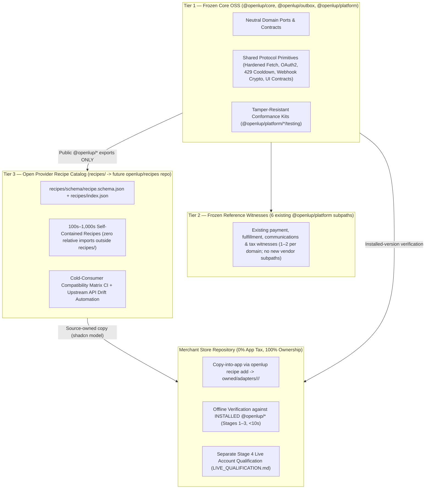
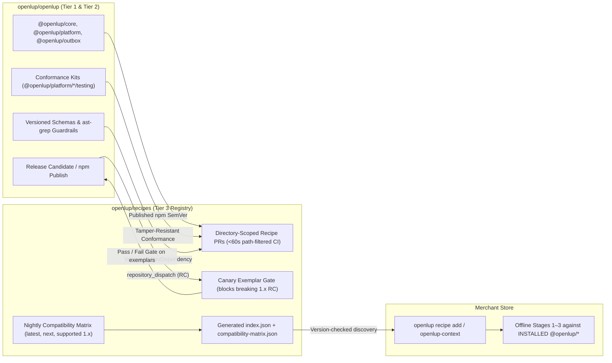

# OpenLup Provider Recipes & Adapter Ecosystem — Master Plan

Status: current strategic architecture and execution plan (living document for stable 1.x; updated via post-recipe retrospectives).  
Audience and purpose: OpenLup maintainers, coding agents, and ecosystem contributors designing, verifying, maintaining, and scaling external provider integrations across hundreds or thousands of services.  
Canonical decision record: [ADR-001: Provider Recipes Architecture, Ownership, and Dependency Contract](adr/ADR-001-provider-recipes-architecture.md).  
Related boundaries: [Architecture and extensions](ARCHITECTURE_AND_EXTENSIONS.md#package-placement-decision-canonical) · [Canonical contracts](CANONICAL_CONTRACTS.md) · [Compose a provider adapter](../../packages/core/docs/guide/how-to/extend/provider-adapters.md) · [Agent-DX regression benchmark](plans/agent-dx-regression.md).

---

## 1. Strategic Thesis: Open Code-Owned Recipes Over Closed Paid Plugin Ecosystems

Traditional commerce ecosystems (Shopify App Store, WooCommerce paid plugins) force merchants into a structural tax:

- **App rent and vendor lock-in:** Essential capabilities (3PL handoff, secondary payment gateways, tax engines, carrier rate quotes, accounting sync) require recurring monthly subscriptions and/or GMV fees.
- **Opaque black boxes:** Integrations run on third-party hosting with separate release cycles, failure modes, rate limits, and trapped state that cannot be inspected, customized, or deterministically tested in CI.
- **Silent ecosystem rot:** Thousands of third-party plugins break silently on platform upgrades because compatibility is self-attested rather than mechanically certified.

**OpenLup's alternative is an open, code-owned, agent-first Provider Recipe ecosystem:**

1. Every integration is a **small, typed, zero-SDK (or structurally injected) adapter living directly inside the merchant's store repository**, implementing OpenLup's **provider-neutral Tier 1 domain ports**.
2. Every recipe is **mechanically certified offline** against OpenLup's tamper-resistant conformance kits and proven wired into real store flows via a **Stage 3 Mount Proof with negative control**.
3. Integrations deploy with the store, incur **0% app tax**, carry **zero third-party hosting dependencies**, and remain **swappable without rewriting domain logic**.
4. The architecture is engineered from day one for **systematic, machine-assisted production and maintenance of hundreds or thousands of recipes** — without turning into unverified "AI slop" or bloating `@openlup/platform`.

---

## 2. Overarching Law: 10x Agent & Developer Experience (DX)

**Agent and Developer DX is the supreme design rule of this entire Master Plan.** Every schema, file layout, CLI contract, conformance error, and documentation page must make adding or swapping a provider **10x faster, safer, and cleaner than any competing commerce platform**:

| DX Principle | Concrete Engineering Standard |
| --- | --- |
| **Zero-Friction Discovery** | One query (`openlup-context search` / MCP) from the **installed** `@openlup/*` version yields the exact domain port, capability matrix, schema, exemplar recipe, and mount point — zero guesswork across scattered manuals. |
| **Zero Boilerplate Hallucination** | Every recipe follows one rigid, predictable directory anatomy (`recipe.json`, `server/`, optional `browser/`, `tests/`, `LIVE_QUALIFICATION.md`), validated against `recipes/schema/recipe.schema.json`. |
| **Actionable Diagnostics (`Observed → Cause → Fix → Recheck`)** | Every conformance, manifest, lint, or mount-proof failure emits deterministic structured diagnostics naming the exact violated invariant, the required fix, and the exact recheck command. |
| **Sub-10-Second Local Proof Loop** | Running Stages 1–3 (`conformance.test.ts` + `mount-proof.test.ts` + manifest/static guards) completes offline in seconds with zero live credentials, zero network access, and zero Docker overhead for pure adapter proofs. |
| **Zero-Ejection Mounting** | Mounting a recipe into the starter store (`examples/neutral-store`) targets explicit `owned/` composition seams (`examples/neutral-store/owned/quote-shipping.ts` pattern) so `openlup upgrade` never conflicts with platform-managed files. |
| **Honest Qualification Boundaries** | Passing offline Stages 1–3 never falsely claims live production readiness; Stage 4 (`LIVE_QUALIFICATION.md`) explicitly governs real sandbox/account verification. |
| **Living Retro Discipline** | Every early recipe and dogfooding simulation triggers a mandatory retrospective; real friction immediately refines this Master Plan, ADR-001, and Tier 1 seams before scaling production. |

---

## 3. Baseline Audit & Three-Track Harmonization Plan (Current State: 2026-11-22)

A full monorepo audit (`packages/core`, `packages/platform`, `server/adapters`, `server/infra`, `src/integrations`, `examples/neutral-store`, `release-gates.json`) established the exact baseline:

### 3.1. What Is Already Strong
- `@openlup/core` is 100% neutral, I/O-free, and browser-safe.
- `@openlup/platform` has **only one runtime dependency (`zod`)**, zero vendor SDK dependencies, and zero ambient environment reads across all TypeScript modules.
- Six opt-in Tier 2 reference adapters exist in `@openlup/platform`: two `stable` payment witnesses (card/wallet and bank-redirect/code), one `stable` warehouse fulfillment witness (platinum-standard implementation), two `experimental` communications witnesses (transactional email and marketing sync), and one `experimental` tax provider witness (alongside neutral `localRateTable`).
- Five offline conformance runners already exist in `@openlup/platform`:
  - `runPaymentAdapterConformance` + `createScriptedPaymentFake` (`@openlup/platform/payments/testing`)
  - `runFulfillmentAdapterConformance` + `createScriptedFulfillmentFake` + `FulfillmentQualification` (`@openlup/platform/fulfillment/testing`)
  - `runTaxAdapterConformance` + `compareTaxRecalculationProbe` (`@openlup/platform/tax`)
  - `runCommunicationsAdapterConformance` (`@openlup/platform/communications`)
  - `runInvoiceAdapterConformance` (`@openlup/platform/invoicing` — exists in code, pending reader-guide parity)
- `examples/neutral-store/owned/quote-shipping.ts` + `examples/neutral-store/test/quote-shipping.test.ts` already prove the zero-ejection owned-seam Stage 3 Mount Proof pattern.

### 3.2. Hard Constraints & Audit Gaps
- **Pack-cap ceiling:** At `1.3.0`, `@openlup/platform` already measures **3.79 MB packed / 18.23 MB unpacked / 4,637+ files** against tight release-gate caps (**4.357 MB / 20.969 MB / 5,330 files**) plus a +30% tarball growth tripwire and lockstep SemVer release across `@openlup/{core,outbox,platform}`. **Adding hundreds of providers inside `@openlup/platform` is mathematically impossible.**
- **Tier 2 reference gaps:**
  - The opt-in email and marketing-sync witnesses do not yet run against the exported `runCommunicationsAdapterConformance`, and lack a `./communications/testing` subpath + scripted fake.
  - Both `stable` payment witnesses carry 11 `@experimental` reference-support exports inside `stable` subpaths.
  - Stage 3 Mount Proofs are missing across the opt-in reference adapters (only the card/wallet witness has an unmounted helper in `examples/neutral-store/host/provider-portable.ts`).
- **Residual neutrality leaks:**
  - Neutral `@openlup/platform` subpaths retain legacy provider/regional field names (`providerMessageId` alias needed in `./communications`, fiscal clearance fields in `./account-support`, regional registry fields in `./company-identity`, hardcoded two-locale unions in `./communications`, `./identity`, `./marketing`).
  - Root reference `server/adapters/` and `server/infra/` still hold regional/legacy stacks (national carrier SOAP stack, regional invoicing/fiscal adapter, national business-registry lookup clients, locker pickup client, and misplaced provider-specific glue inside managed persistence adapters).

### 3.3. Three-Track Harmonization Strategy (Keep, Clean, Migrate)

We **do not** delete or break the existing `@openlup/platform` reference adapters. Instead, we execute three parallel tracks:

- **Track A — Freeze & Polish the Existing Tier 2 Reference Witnesses (`@openlup/platform`):**
  1. **Freeze new vendor subpaths in `@openlup/platform`.** Keep the six existing reference witnesses solely as living contract witnesses (1–2 per domain). All new provider growth (Adyen, Amazon MCF, ShipBob, Postmark, Avalara, TaxJar, QuickBooks, Xero, etc.) goes to Tier 3 Recipes.
  2. Standardize `/testing` subpaths (`./communications/testing`, `./invoicing/testing`, `./channels/testing`, `./tax/testing`) and wire the existing email and marketing-sync witnesses through the public communications conformance kit.
  3. Add zero-ejection `owned/` mount seams in `examples/neutral-store/owned/` (planned `<starter>/owned/payment-rail.ts`, `<starter>/owned/email-transport.ts`, `<starter>/owned/fulfillment-adapter.ts`, `<starter>/owned/invoice-provider.ts`) mirroring `examples/neutral-store/owned/quote-shipping.ts`.
  4. Keep the 11 `@experimental` payment reference-support helpers frozen (no additions in 1.x; deprecate/remove in 2.0).

- **Track B — Surgical Neutrality Cleanup (P0 → P2):**
  - **P0 (completed alongside this plan):** Scrub real personal PII from national registry lookup comments and company-identity/support test fixtures; remove hardcoded personal email fallback from `privateLabelB2BInquiryPresenter.ts`; neutralize the reference bank-redirect/code payment factory (parameterized neutral return paths, `subject` query param, neutral payer fallback; no localized or industry defaults).
  - **P1 (neutral platform contracts & reference stubs):** Introduce additive neutral aliases (`providerMessageId`, neutral fiscal clearance fields, generic `Locale extends string`), neutralize `server/adapters/accounting/testAccountingProvider.ts`, `server/adapters/localReferenceStoreAdapter.ts`, `server/adapters/paymentFailureDisplay.ts`, `server/adapters/managed/commerce/commerceRuntimePort.ts`, `src/integrations/` (remove hardcoded fallback locale, parameterize auth callback path, make admin client lazy), and retire stale server/infra/vendorRegistry.ts.
  - **P2 (host boundary cleanup):** Remove direct ambient environment reads in root `server/adapters/` and extract misplaced provider-specific glue out of managed persistence adapters.

- **Track C — Graduate Regional/Legacy Reference Adapters into Tier 3 Recipes:**
  - Convert regional carrier, locker, invoicing, and national registry reference stacks into standalone Tier 3 Recipes once their respective Tier 1 ports/conformance kits are complete, removing them from the generic reference host.

---

## 4. Three-Tier Topology & Splittable Registry Architecture



### Monorepo Incubation → Mechanical Split to `openlup/recipes`
Recipes incubate in top-level `recipes/` inside this monorepo so contract evolution, conformance kits, and early exemplar recipes stay tightly synchronized. To guarantee that splitting `recipes/` into a standalone public repository (`openlup/recipes`) later is **purely a mechanical operation** (`git subtree split --prefix=recipes`), `recipes/` obeys **ADR-001's strict isolation boundary**:
- Every file under `recipes/` imports **ONLY** public `@openlup/*` package exports, Node standard built-ins (in `server/` and `tests/` only), and relative files within `recipes/`.
- **Zero** imports from `../../packages/*/src/**`, `../../server/**`, `../../src/**`, or `../../examples/**`.
- **Zero** third-party vendor SDK dependencies by default (`zero-dep-fetch` or `injected-structural-client`).
- **Zero** impact on `@openlup/platform` npm tarball size caps or lockstep SemVer releases.

### 4.1. Monorepo vs. Standalone `openlup/recipes`: Scaling Impact, Split Triggers & Cross-Repo Consistency

Incubating the first 5–15 recipes inside `openlup/openlup` is intentionally optimal while Tier 1 ports, conformance kits, and DX enablers are warming up (Wave 1B proved how tightly recipe dogfooding feeds back into `@openlup/platform`). Beyond that incubation window, empirical Wave 1C measurements establish clear scaling limits for both core OpenLup CI and recipe delivery velocity.

#### Measured Impact on OpenLup Core CI & Test Suite
Measured baseline on `main` at 5 shipped recipes (`payments/adyen`, `payments/mollie`, `fulfillment/amazon-mcf`, `fulfillment/shipbob`, `tax/avalara`): **54 files, ~24.4k LOC, 10 Vitest files (63 tests running in 0.77s offline)** — averaging ~9 files, ~4.8k LOC, and 2 Vitest files per recipe:

| Catalog Scale | Files / LOC in `recipes/` | Added Root Vitest Load (`test-full-shard`) | Added Static / Catalog Overhead (`eslint .`, `ast-grep`, `gitleaks`, `oss:published-tree`) | Impact on OpenLup Core |
| --- | --- | --- | --- | --- |
| **5 recipes (Wave 1C baseline)** | 54 files / ~24.4k LOC | 10 files / ~0.8s | Negligible (~1–2s); +45 paths in `config/openlup-publication-catalog.json` (~0.5% of 8,002 entries) | **Negligible** — optimal incubation range |
| **15–25 recipes** | ~150–240 files / ~75k–120k LOC | 30–50 files / ~3–5s | Noticeable in root `eslint .` (+5–10s) and catalog/inventory scans | **Warning threshold** — begin split preparation |
| **100 recipes** | ~900+ files / ~480k LOC | 200 files / ~15–25s on every core PR | `eslint .`, `ast-grep`, `gitleaks`, neutrality scans, SonarCloud, and `config/openlup-publication-catalog.json` grow substantially on every core PR | **High core tax** — degrades core developer DX |
| **1,000 recipes** | ~9,000+ files / ~4.8M LOC | 2,000 files (+2–4 min on every core PR across shards) | Publication catalog more than doubles (~8k → ~17k paths); git history and Merge Queue become dominated by recipe churn | **Unacceptable** — stalls monorepo |

#### Measured Impact on Recipe Development Velocity
Empirical Wave 1C execution (shipping 3 recipes in parallel) showed that monorepo coupling slows **recipe velocity** far earlier than it slows core tests:
1. **30-Minute Core CI for a 0.3-Second Recipe (~50×–100× Overhead):** Every recipe-only PR in `openlup/openlup` runs the full `published-tree-ci.yml` pipeline (workspace package build, 8 Vitest shards with PostgreSQL containers, `pgtap`, 4 Playwright `install-browser` groups, `install-packages`, `self-check`, `SonarCloud`) twice (PR + Merge Queue) — ~25–30 wall-clock minutes per recipe vs. **<45–60 seconds** in a standalone `openlup/recipes` repository with path-filtered CI.
2. **Merge Queue Serialization & Hot-File Contention:** Because every Wave 1C recipe PR touched 4 shared files (`recipes/index.json`, `recipes/README.md`, `docs/platform/PROVIDER_RECIPES_MASTER_PLAN.md`, and `config/openlup-publication-catalog.json`), parallel recipe PRs collided in GitHub Merge Queue, forcing sequential landing, manual conflict merges, and extra integration-review cycles. In a monorepo, throughput caps at ~2–3 recipes/hour regardless of how many Tier B fast workers or community contributors run in parallel.
3. **Coupling to Unrelated Core Flakes & Policies:** Unrelated core test flakes (e.g., transient shard timeouts in root script tests) or unrelated core queue backlogs directly block and evict independent recipe PRs.
4. **Heavy External Contributor Onboarding:** External payment/3PL/tax vendors contributing a recipe should not need to clone OpenLup's database migrations, storefront, PostgreSQL harnesses, and 8,000-file publication catalog.

#### Pre-Split & Post-Split Structural Mitigation: Eliminate Hot Files
Before scaling past ~10 recipes (and mandatory in `openlup/recipes`):
- **Single Source of Truth per Recipe Directory:** A recipe PR modifies **only** `recipes/<domain>/<provider>/**` (zero edits to `recipes/index.json`, `recipes/README.md`, or a shared retro table).
- **Deterministic Post-Merge Index Generation:** A deterministic generator script/workflow compiles `recipes/index.json` (and the catalog summary) automatically from all `recipes/*/*/recipe.json` manifests after merge, eliminating cross-PR merge conflicts completely.

#### Quantitative Split Triggers & Exit Criteria (When to Split into `openlup/recipes`)
Execute the mechanical `git subtree split --prefix=recipes` into standalone `openlup/recipes` as soon as **any** trigger is reached:
- **Scale Trigger:** `>= 15` recipes in `recipes/` (or `> 150` files / `> 75k` LOC under `recipes/`).
- **Throughput Trigger:** `>= 3` concurrent recipe PRs per week (or initiating batch Tier B worker runs of `>= 5` recipes per wave).
- **Ecosystem Trigger:** Onboarding the first external partner/community recipe contributor or shipping `openlup recipe add` backed by a remote registry index.

**Mandatory Exit Criteria Before Executing the Split:**
1. At least one certified `exemplar` recipe exists per active Wave 1 domain (`payments`, `fulfillment`, `tax`, and `shipping` once `CarrierRateQuotePort` lands).
2. `@openlup/platform@1.4.0` is published on npm (so standalone recipes consume Wave 1B DX enablers directly from npm without monorepo workspace links).
3. Deterministic `recipes/index.json` generation from per-recipe `recipe.json` files is in place.

#### Six-Pillar Cross-Repo Consistency Architecture (After Splitting to `openlup/recipes`)
Moving recipes out of the monorepo must **never** re-create the broken-plugin ecosystem of traditional commerce platforms. Consistency between `openlup/openlup` and `openlup/recipes` is enforced mechanically through six mechanisms:



1. **Cold-Consumer npm Contract Spine:** `openlup/recipes` installs `@openlup/core`, `@openlup/platform`, and `@openlup/outbox` strictly from npm (never workspace source links). Every recipe CI run is automatically a genuine **cold-consumer proof**, preventing accidental imports of unreleased symbols.
2. **Bidirectional CI Loop (RC Exemplar Gate + Nightly Matrix):**
   - **Pre-Release Canary Gate (`openlup/openlup` → `openlup/recipes`):** Before promoting a new `@openlup/platform` `1.x` release candidate to `latest`, `openlup/openlup` dispatches a `repository_dispatch` event with the candidate version/tarball to `openlup/recipes`, which runs all `status: "exemplar"` recipes (1–2 per domain). Any regression on an `exemplar` blocks the `1.x` promotion until resolved in core or explicitly scoped to a major version. Non-exemplar (`verified`/`community`) failures generate non-blocking compatibility reports so third-party churn can never block core releases.
   - **Nightly Compatibility Matrix (`compatibility-matrix.json`):** Scheduled sharded CI runs every recipe against `@openlup/platform@latest`, `@next`, and the active supported `1.x` window, emitting a machine-readable `compatibility-matrix.json` artifact (`recipeId`, `recipeTreeSha256`, `verifiedAgainst[]`, `status: "verified" | "unverified-for-<version>" | "deprecated"`). Both `openlup recipe add` and `openlup-context` filter/warn against the merchant's **installed** `@openlup/platform` version.
3. **Zero-Contention Directory-Scoped PRs & Path-Filtered CI:** Each recipe PR touches only its own directory (`recipes/<domain>/<provider>/**`), runs strict `tsc`, domain conformance + Stage 3 mount proofs, `ast-grep`, `eslint`, and manifest schema checks **only for changed recipe directories** (<60s), and triggers post-merge generation of `index.json`. Dozens of Tier B agents or external contributors can merge in parallel with zero Merge Queue conflicts.
4. **Versioned Guardrails & Schemas Distributed from Core:** `recipe.schema.json`, `csp.schema.json`, manifest validator helpers, and the recipe `ast-grep` / ESLint rule pack are versioned and published from `openlup/openlup` (either as a compact subpath or lightweight companion package) and consumed by `openlup/recipes` as a pinned devDependency — ensuring new security rules propagate mechanically without copy-paste drift.
5. **Two-Step Tier 1 Port Evolution:** When a new integration domain requires a new Tier 1 port (e.g., `CarrierRateQuotePort`, `AccountingLedgerExportPort`), (a) land the port, its `./<domain>/testing` conformance kit, and one minimal synthetic witness in `openlup/openlup` and release minor `1.x`; then (b) bump `@openlup/platform` in `openlup/recipes` and fan out dozens of provider recipes via Tier B workers without touching core.
6. **Automated Upstream Provider API Drift Maintenance:** Scheduled maintenance agents operate solely inside `openlup/recipes` (monitoring provider OpenAPI/webhook changelogs and opening recipe PRs verified by the 5 anti-slop gates), keeping high-frequency vendor churn completely isolated from `openlup/openlup` history.

---

## 5. Canonical Recipe Anatomy (v1)

Every provider recipe uses one standardized, machine-readable directory structure:

```text
recipes/<domain>/<provider>/              # Or recipes/multi/<provider>/ for multi-domain providers
├── recipe.json                           # Machine-readable manifest validated against recipes/schema/recipe.schema.json
├── server/
│   ├── client-contract.ts                # Narrow structural transport/HTTP interface (3–8 methods or fetch contract; zero SDK)
│   ├── adapter.ts                        # Thin protocol translator (default-off, zero ambient env reads, redirect:"error", strict redaction)
│   ├── webhook.ts (or hmac.ts)           # Raw-byte / canonical cryptographic signature verifier (timingSafeEqual, body cap, freshness)
│   └── index.ts                          # Inert public barrel (0 I/O, 0 env reads, 0 side effects on import)
├── browser/                              # OPTIONAL (only when provider exposes browser UI: Drop-in, Elements, Pickup Map)
│   ├── index.ts                          # Zero Node imports; neutral UI contracts + degraded/fallback states + lazy script loading
│   └── csp.json                          # Declarative CSP delta (script-src, frame-src, connect-src) validated by csp.schema.json
├── tests/
│   ├── fixtures.ts                       # Deterministic offline fixtures: happy, replay, scripted faults, declines, zero-I/O refusals, canaries
│   ├── conformance.test.ts               # Stage 1 + Stage 2: public domain conformance kit + manifest check + cold-import + canary + planted defects
│   └── mount-proof.test.ts               # Stage 3: wires adapter into real @openlup/platform rails + negative control proving unmounting fails
└── LIVE_QUALIFICATION.md                 # Stage 4: explicit checklist for test-account credentials, webhook signing, and readback
```

### Multi-Domain Provider Pattern (e.g., Amazon = Channels + MCF; Multi-Capability Marketing Providers)
Following the proven opt-in marketing-sync witness pattern:
- Place shared private transport, signing, origin pinning, and rate-limit cooldown in a private `core/` module.
- Expose **independent, opt-in domain facets** (`payments/`, `fulfillment/`, `tax/`, `channels/`) with **strict failure isolation** (an uncertain call in one facet never quarantines another) and independent conformance certification per domain.

### Browser / UI Component Pattern (e.g., Adyen Drop-in, Embedded Payment Widgets, Pickup Maps)
- Strict physical split: `browser/` contains zero Node built-ins and zero server imports.
- Every browser recipe ships `<recipe>/browser/csp.json` (matching `recipes/schema/csp.schema.json`) declaring minimal CSP directives (`script-src`, `frame-src`, `connect-src`, `img-src`) so merchants never weaken CSP blindly.
- Mandatory degraded/fallback states (`unavailable`, `loading`, `loadFailed`, `loadRetry`, `loadAlternative`) and lazy script injection (never global `<script>` tags).

---

## 6. Four-Stage Proof Standard & Five Anti-Slop Mechanical Gates

Mass-producing hundreds or thousands of recipes with AI agents fails if tests are tautological mocks. Every recipe must clear **all 4 proof stages** and **all 5 mechanical anti-slop gates** before earning a verified entry in `recipes/index.json`:

### 6.1. Four-Stage Proof Standard

| Stage | What It Proves | Offline / CI? |
| --- | --- | --- |
| **Stage 1: Cold-Import, Capability & Zero-I/O Refusal Proof** | Importing & constructing the adapter executes 0 network calls and 0 ambient environment reads; unsupported operations, currencies, countries, or missing required context refuse before dispatch (`providerRequests === 0`). | Offline · Always in CI |
| **Stage 2: Domain Conformance Certification** | Passes the official Tier 1 conformance runner (`@openlup/platform/*/testing`) with scripted transport faults (`timeout-before-dispatch`, `provider-5xx-before-dispatch`, `timeout-after-dispatch`, `redelivery-409`), idempotent replay, webhook safety probes (duplicate, signature mismatch, partial/zero/missing money, chargeback), and strict money fidelity. | Offline · Always in CI |
| **Stage 3: Real-Flow Mount Proof (+ Negative Control)** | Wires the recipe into the real `@openlup/platform` composition rails (e.g. `createPaymentProviderRegistry` + `createVerifiedPaymentIngress` + `createPostgresProviderPaymentRail` / `createDbBackedCommerceQuotePort`) and proves real state progression AND that detaching/breaking the mount fails the test (eliminating the `t3` "unmounted passing unit test" failure mode from `agent-dx-regression.md`). | Offline · Always in CI |
| **Stage 4: Live Sandbox / Account Qualification** | Real credentials, real webhook signing, and real dashboard readback on a disposable merchant test account via `LIVE_QUALIFICATION.md`. Strictly separate from offline CI — Stages 1–3 never claim live account readiness. | Staging / Manual gate |

### 6.2. Five Anti-Slop Mechanical Gates
1. **Tamper-Resistant Conformance Receipt:** Generalize `FulfillmentQualification` (`packages/platform/src/fulfillment/adapterConformance.ts`) across all domains: reject `Proxy` subjects, authenticate scripted fault logs via private handles, validate outputs with Zod, and stamp `(recipeTreeSha256, openlupPlatformVersion, capabilityDigest, passedCases[])` into the recipe's certification metadata.
2. **Serializable Static Capabilities Cross-Check:** Because runtime capability descriptors may include function hooks (e.g., `assessMandate`) and host-injected lists (e.g., `supportedCurrencies`), tests assert `deepStrictEqual` between `recipe.json#staticCapabilities` and the adapter's deterministic serializable static projection (omitting functions and modeling host-configured arrays explicitly via `supportedCurrenciesPolicy`).
3. **Cold-Import Subprocess / Zero-Ambient-I/O Gate:** Verify zero ambient environment reads and zero calls to global `fetch` on import and construction.
4. **Secret/PII Canaries & Planted-Defect Self-Checks:**
   - Inject synthetic canary strings (API credential, HMAC key, payer email, transient secret, raw provider session tokens such as Adyen `sessionData`) into inputs and mocked provider error bodies; assert **zero occurrences** (raw or URL-encoded) across `{ execution, persistence, diagnostics, thrownErrors }` (because `@openlup/platform/payments/testing` does not yet scan `persistence` or thrown errors).
   - Include at least 2 planted-defect negative controls proving the test suite fails if signature verification or zero-I/O refusal checks are bypassed.
5. **Static Guardrails (`ast-grep` + ESLint + Strict `tsc`):**
   - Enforced directly in `eslint.config.js`, `scripts/ast-grep/rules/domain-no-environment-reads.yml`, `scripts/ast-grep/rules/recipes-no-ambient-fetch.yml`, and standalone `recipes/tsconfig.json`: ban ambient environment reads, `node:process`, ambient global `fetch(`, relative escapes outside the recipe root, vendor SDK imports, and Node/`../server` imports inside `browser/`.
   - Require `redirect: "error"` on outbound HTTP requests (preventing 307/308 mutating replay) and allowlisted diagnostic codes (`^[A-Z][A-Z0-9_]{0,63}$`).

---

## 7. Shared Tier 1 Platform Enablers (Keeping Recipes Under ~250–450 LOC)

Before scaling to mass recipe generation, invest targeted Tier 1 bytes into `@openlup/platform` so recipes never duplicate subtle security or resilience code:

1. **Shared Protocol Primitives** (in `@openlup/platform/http` or a compact `./adapter-kit` rail):
   - `createHardenedFetch` (`redirect: "error"`, HTTPS origin pinning, composed timeout `AbortSignal`, bounded body reader, safe diagnostic code allowlist).
   - `createOAuth2TokenManager` (client-credentials / refresh-token, single-flight dedupe, injected `clock`, host-owned token cache).
   - `createRetryAfterCooldown` (`429` + `Retry-After` pacing helper generalized from the marketing-sync witness).
   - Expanded Webhook Crypto Verifiers (Standard Webhooks/Svix `whsec_`, Base64 HMAC-SHA256, Ed25519/JWS alongside existing hex HMAC).
2. **Browser Payment UI Contracts & Public Wiring Types (0 B runtime):**
   - Promote `PaymentFormCopy`, `PaymentFormSettlement`, and `RecoveryPaymentSetupFormCopy` (`src/domains/payment/paymentFormContracts.ts`) into type-only `@openlup/platform/payments/contracts`.
   - Re-export `PaymentWebhookControlPort`, `NormalizedProviderPaymentWebhook`, `PaymentWebhookMethodRefPort`, and `PaymentProviderExecutor` from `@openlup/platform/payments` (eliminating `Parameters<typeof ...>` boilerplate in standalone Stage 3 Mount Proofs).
   - Export a safe `brandTransientSecret(value: string): TransientSecret` helper so recipes never need unsafe `as TransientSecret` casts.
3. **Conformance Kit & Contract Parity (including Dogfooding & Retro discoveries):**
   - Publish `./communications/testing`, `./invoicing/testing`, `./channels/testing`, and `./tax/testing` parity with scripted fakes.
   - Strengthen `./payments/testing`: accept `"sent_to_provider"` in `paymentSafetyConformance.ts:192` (matching `PAYMENT_EXECUTION_ATTEMPT_STATUSES`), enforce 64-hex `fingerprint` format (`/^[0-9a-f]{64}$/` required by `createPostgresPaymentWebhookControlPort`), scan `persistence` and thrown errors for secret/handoff leaks, emit structured diffs on fixture mismatch, and add `capabilityDigest` certification receipts.
   - Extend `PaymentRefundObservation` additively to support delta-only refund webhooks (such as Adyen `REFUND` notifications, which carry the refunded delta amount without echoing the original payment total).
4. **Missing Tier 1 Domain Ports (Global / US-First Priority):**
   - **Tax (`TaxCalculationPort` + `runTaxAdapterConformance` — ALREADY LANDED on `main`):** Supports tax-inclusive and tax-exclusive calculation + recalculation probes; ready for Wave 1 Tier 3 recipes (`tax/avalara`, `tax/taxjar`) alongside the existing Tier 2 tax witness.
   - **Carrier Rate Quoting (`CarrierRateQuotePort` + `./shipping/testing`):** Formalizes the `examples/neutral-store/owned/quote-shipping.ts` seam into a dedicated port + conformance runner; drives USPS, UPS, FedEx, EasyPost, ShipEngine.
   - **Accounting / ERP Sync (`AccountingLedgerExportPort` + `./accounting/testing`):** Durable outbox export of paid orders, taxes, payouts, and refunds; drives QuickBooks Online, Xero.
   - **Observability (`TelemetryPort`):** Redacted structured spans, metrics, and error sinks; drives Axiom, OpenTelemetry, Sentry, Datadog.

---

## 8. Agent-DX Acceleration Layer (Built on Existing OpenLup Tooling)

Build directly on existing OpenLup binaries and protocols rather than introducing new tools:

1. **Discovery via `openlup-context` (`@openlup/core`):** Publish recipe guides under `packages/core/docs/guide/how-to/extend/` (auto-indexed by `openlup-context search` and `search_openlup_context` MCP).
2. **Unified `openlup recipe` CLI & MCP Subcommands (`packages/platform/src/lifecycle/openlup.mjs`):** Follow the exact `formatVersion: 1`, exit codes (`0/1/2/64/74`), and `Observed → Cause → Fix → Recheck` envelope proven in `openlup catalogue project` and `openlup settings mcp`:
   - `openlup recipe list [--domain <domain>] [--json]`
   - `openlup recipe show <id> [--json]`
   - `openlup recipe scaffold --domain <domain> --provider <name>`
   - `openlup recipe add <id> [--dest <dir>]` (copies source-owned recipe into the merchant's `owned/` tree and records provenance)
   - `openlup recipe verify <path> [--json]` (runs manifest validation, static guardrails, Stages 1–3, and emits a certification receipt)
3. **Automated Upstream API Drift & Compatibility Maintenance Loop:**
   - Nightly registry CI runs cold-consumer verification of all recipes against `@openlup/platform@latest` and `@openlup/platform@next`; failing recipes flip automatically to `unverified-for-<version>`.
   - Scheduled maintenance agents monitor upstream provider OpenAPI/webhook changelogs, open PRs updating normalizers/fixtures, and verify Stages 1–3 automatically.
4. **Agent-DX Benchmark (`docs/platform/plans/agent-dx-regression.md`):** Add task `t5: new-provider-recipe` measuring *Time-to-Verified-New-Provider* (Stages 1–3 passing, zero managed file ejections, negative controls passing).

---

## 9. Execution Discipline: Specification-First Waves & Tiered Model Routing

Scaling from 1 exemplar recipe to hundreds or thousands of provider recipes requires two non-negotiable operational disciplines: **high-rigor upfront specifications for every wave/stage** and **tiered model + reasoning routing** so execution scales at low cost and high speed without ever relaxing the 5 anti-slop gates.

### 9.1. Mandatory Wave & Stage Specifications (Spec-First Gate)
No wave, new Tier 1 port, or recipe batch may enter implementation until a **complete, reviewable Wave/Stage Specification** is written and accepted. Every specification MUST define:

1. **Exact Target Surface & Port Signatures:** Canonical `@openlup/*` subpath imports, capability matrix (`supported` / `unsupported`), and explicit non-goals.
2. **Protocol & Security Quirks:** Authentication/signing algorithm (e.g., HMAC canonicalization, hex/base64 key decoding, OAuth2/SigV4), live/test origin pinning rules, capture/settlement semantics, idempotency headers, and provider HTTP acknowledgement quirks (such as Adyen's `[accepted]` body).
3. **Failure, Refusal & Uncertainty Taxonomy:** Mapping of provider declines and transport faults onto OpenLup neutral classes (`PaymentFailureHint`, zero-I/O `notDispatched`, `unknown` uncertainty preservation, and honest `unsupported` refusals).
4. **Verification Contract & Acceptance Criteria:** Required Stage 1–3 fixtures, secret/PII canary list, planted-defect negative controls, exact Stage 3 Mount Proof rails, and exact verification commands (`tsc -p recipes/tsconfig.json --noEmit`, `vitest`, `ast-grep`, `eslint`).
5. **Reference Exemplar Pointer:** Which existing certified recipe (e.g., `recipes/payments/adyen`) acts as the structural template to clone.

> **Why this matters:** A crystal-clear specification eliminates guesswork, prevents architectural drift across contributors/agents, and makes bounded execution tasks safe to delegate to fast, lower-cost worker models.

### 9.2. Tiered Model & Reasoning Routing (Recipe Factory Economics)
Not every step in the Recipe Factory requires frontier reasoning. Route work explicitly by task complexity while keeping **identical mechanical verification gates** across all tiers:

| Execution Tier | Model / Reasoning Profile | When to Use | Mandatory Guardrails |
| --- | --- | --- | --- |
| **Tier A — Architect & Spec Lead** | High-capability model · high reasoning effort | Authoring Wave/Stage Specifications; designing new Tier 1 ports and `./*/testing` conformance kits; novel/complex protocols (e.g., Amazon SigV4 + LWA OAuth2, multi-domain failure isolation); pre-implementation dogfooding simulations; post-wave retrospectives and ADR amendments. | Human/maintainer review + full repo verification. |
| **Tier B — Standard Execution Worker** | Lighter/faster model · lower reasoning effort | Well-bounded, straightforward tasks backed by a complete Wave Specification and an existing certified exemplar (e.g., cloning `payments/adyen` for another standard REST/JSON payment gateway, adding deterministic fixtures/canaries, updating `recipe.json`/`csp.json`/`index.json`, routine P1/P2 neutrality cleanups, mechanical doc/manifest updates). | **Zero gate relaxation:** output MUST pass `tsc -p recipes/tsconfig.json --noEmit`, official `run*AdapterConformance`, `mount-proof.test.ts` (+ negative controls), secret/PII canaries, `ast-grep`, and `eslint`. |
| **Tier C — Mechanical / Boilerplate Worker** | Fastest lightweight model · minimal reasoning | Purely mechanical transforms (scaffolding directory skeletons, generating `files.allFiles` inventories, formatting/index regeneration, running read-only inventory scans). | Exact schema/lint check + zero behavioral changes. |

### 9.3. Automatic Escalation & Spec Feedback Loop
- If a **Tier B/C fast worker** hits an unspecified protocol edge case, fails conformance/typecheck after bounded retries (e.g., 2 repair attempts), or encounters a Tier 1 contract mismatch, **stop retrying on the smaller model and escalate to Tier A**.
- Every Tier A escalation MUST update the Wave Specification and the [Living Retro Log](#11-living-retro-log--plan-evolution) so subsequent fast workers execute cleanly on the first pass.

### 9.4. Autonomous Delivery & Decision Authority (Bounded by Human Authority)
- **Authority Rule (`AGENTS.md` & `CONTRIBUTING.md`):** This plan and review receipts grant no submission, merge, release, settings, or credential authority on their own. All delivery and merge actions remain strictly bounded by the accountable human's actual granted task and delivery authority.
- **Lead Agent Execution (Within Granted Authority):** When the accountable human grants task and auto-merge authority for a wave, routine technical and implementation decisions that stay within this Master Plan, [ADR-001](adr/ADR-001-provider-recipes-architecture.md), and the active Wave Specification are resolved autonomously by the Lead Agent, and changes that pass the full verification and native-review procedure (`tsc --noEmit`, Stages 1–3 tests, canaries/negative controls, `ast-grep`, `eslint`, `npm run preflight`, DCO, native review receipt, and hosted CI per `CONTRIBUTING.md`) may be armed for auto-merge within that authority.
- **Owner Escalation Boundary (Always Required):** Escalate to the accountable human for any decision outside granted authority or outside this plan — including breaking public SemVer contracts, creating/bootstrapping external repositories (`openlup/recipes`) or npm packages, modifying release/pack caps, live account/production releases, or changing strategic priorities/scope.

---

## 10. Global / US-First Phased Provider Roadmap

> **Gate:** Every wave below starts by finalizing its Wave Specification (§9.1) before dispatching Tier A/B/C execution workers (§9.2).

### Wave 0: Exemplar Blueprint & Dogfooding (Completed Baseline)
- **P0 Neutrality Cleanup:** Completed across national registry lookup comments, `privateLabelB2BInquiryPresenter.ts`, reference bank-redirect/code payment factory, and test fixtures.
- **Canonical Master Plan + ADR-001 + `recipes/schema/recipe.schema.json`:** Established.
- **Pre-Implementation Dogfooding Simulation:** Fresh-developer/agent dry-run adding Adyen before implementation, feeding improvements directly into this plan and ADR-001.
- **Exemplar Recipe #1 — `payments/adyen` (Global / US Enterprise Payments):**
  - Zero-SDK injected `fetch` against Adyen Checkout v71 (`POST /sessions`, `POST /payments`, `POST /payments/{pspReference}/cancels`), native integer minor units `{ currency, value }`.
  - Proves `client-confirmed` (`TransientSecret` for Adyen Drop-in UI) + `redirect` fallback + unattended `ContAuth` recurring renewals + `close` cancellation + honest `readback: "unsupported"` zero-I/O refusal + Adyen canonical HMAC-SHA256 webhook verification + `browser/` Drop-in contract & `csp.json` + Stages 1–3 tests + `LIVE_QUALIFICATION.md`.

### Wave 1: Global / US Multi-Domain Production Breadth
- **Wave 1 Spec Required First:** Specify `fulfillment/amazon-mcf` (LWA OAuth2 + SigV4 + `FulfillmentQualification` `mode: "full"`), Tier 1 Retro fixes (`paymentSafetyConformance.ts` `"sent_to_provider"`, public webhook/UI contract exports), `tax/avalara` (on already-landed `TaxCalculationPort` + `runTaxAdapterConformance`), and Tier 1 `CarrierRateQuotePort` contracts.
- **Exemplar Recipe #2 — `fulfillment/amazon-mcf` (Amazon Multi-Channel Fulfillment, US/Global 3PL):** Proves `@openlup/platform/fulfillment/testing` `mode: "full"` (`FulfillmentQualification`), LWA OAuth2 + SigV4 transport isolation, and delayed delivery alignment.
- **Tier 1 Enablers & Tax Breadth:** `CarrierRateQuotePort` (`shipping/easypost`, `shipping/usps`), `tax/avalara` (second tax provider proving `TaxCalculationPort` replaceability), `owned/` mount seams in `examples/neutral-store`.
- **Additional Wave 1 Global Recipes (eligible for Tier B fast workers once specs & exemplars exist):** `communications/postmark` (after `./communications/testing`), `fulfillment/shipbob`, `payments/mollie` (EU reference).

### Wave 2: Accounting, Observability & Multi-Provider Replaceability
- **Wave 2 Spec Required First:** Specify `AccountingLedgerExportPort`, `TelemetryPort`, and OAuth2/polling shared primitives before recipe fan-out.
- `accounting/quickbooks-online` & `accounting/xero` (on `AccountingLedgerExportPort`).
- `observability/axiom` & `observability/otel-otlp` (on `TelemetryPort`).
- `payments/paypal` / `payments/braintree`, `shipping/shipengine`, `channels/shopify`.

### Wave 3: Standalone `openlup/recipes` Split & Mass Recipe Factory (100s–1,000s)
- **Wave 3 Spec Required First:** Specify standalone `openlup/recipes` repository layout, deterministic `index.json` + `compatibility-matrix.json` generation, RC exemplar `repository_dispatch` gate (§4.1), versioned guardrail distribution, and `openlup recipe add|scaffold|verify` CLI/MCP contract.
- **Execute Split at §4.1 Quantitative Triggers:** Mechanical `git subtree split --prefix=recipes` into public `openlup/recipes` once the §4.1 scale (`>= 15` recipes), throughput (`>= 3` concurrent recipe PRs/week), or ecosystem triggers fire and all exit criteria are met.
- Ship `openlup recipe add|scaffold|verify` CLI & MCP commands consuming `index.json` + `compatibility-matrix.json` against the merchant's installed `@openlup/platform` version.
- Open community, partner, and Tier B agent-worker PR pipeline governed automatically by the 5 anti-slop gates, directory-scoped zero-contention PRs (<60s path-filtered CI), and bidirectional cross-repo compatibility CI (§4.1).
- Migrate Track C regional reference adapters (national carrier SOAP, locker pickup, regional fiscal/invoicing, and national business registries) into the registry as regional packs.

---

## 11. Living Retro Log & Plan Evolution

> **Rule:** Whenever dogfooding or early recipe implementation uncovers contract friction, missing Tier 1 helpers, ambiguous docs, or DX papercuts, record the observation here and update the relevant sections of this Master Plan and [ADR-001](adr/ADR-001-provider-recipes-architecture.md) in the same change.

| Date | Trigger | Key Finding | Action Taken |
| --- | --- | --- | --- |
| 2026-11-22 | Initial 4-agent baseline audit | `@openlup/platform` is at 87% pack cap (3.79/4.357 MB); 3 P0 PII/legacy leaks found in root reference adapters; `runInvoiceAdapterConformance` exists undocumented; communications witnesses bypass public communications conformance runner; `packages/platform/src/tax/` landed on `main` with `TaxCalculationPort` + `runTaxAdapterConformance`. | Froze Tier 2 at existing witnesses; adopted splittable `recipes/` architecture; executed P0 cleanup; scheduled Track A/B/C harmonization. |
| 2026-11-22 | Pre-implementation Adyen dogfooding simulation (fresh-agent dry-run) | Surfaced 9 high-impact DX/contract gaps before writing code: (1) raw `deepStrictEqual(manifest.capabilities, runtime.capabilities)` impossible due to `assessMandate` function & host-injected `supportedCurrencies`; (2) `egressOrigins` regex rejected `{liveUrlPrefix}`; (3) `files` duplicated `browserSurface` and omitted `allFiles`; (4) `recipes/` was invisible to Vitest, ESLint isolation, and `ast-grep`; (5) `csp.schema.json` & `recipes/index.json` missing; (6) `PaymentRefundObservation` requires `originalPaymentMoney` absent in Adyen `REFUND` webhooks; (7) `adapterConformance.ts` does not check 64-hex `fingerprint`, `persistence` secret leaks, or `providerOccurredAt` settlement gate; (8) `PaymentWebhookControlPort`/`PaymentProviderExecutor`/`PaymentFormCopy` not yet exported on public subpaths; (9) async `close()` with `readback: "unsupported"` must return `pending`/`unknown`, never fabricated `failed`. | Fixed `recipe.schema.json` (`staticCapabilities`, `supportedCurrenciesPolicy`, `{placeholder}` origins, `allFiles`), added `csp.schema.json` and `recipes/index.json`, wired `recipes/` into `vitest.config.ts`, `eslint.config.js`, `domain-no-environment-reads.yml`, and `recipes-no-ambient-fetch.yml`, updated ADR-001 & Master Plan §6–§7 with Tier 1 backlog items and offline Stage 3 playbook. |
| 2026-11-22 | Post-implementation `payments/adyen` exemplar retro | Implementing and typechecking `recipes/payments/adyen` surfaced 4 concrete platform/tooling lessons: (1) `paymentSafetyConformance.ts:192` checks `["pending", "processing", "requires_action", "failed"]` and omits `"sent_to_provider"` from `PAYMENT_EXECUTION_ATTEMPT_STATUSES` — uncertain transport envelopes must use `status: "processing"` until Tier 1 testing aligns; (2) Vitest strips types without checking them, so a standalone `recipes/tsconfig.json` (`tsc -p recipes/tsconfig.json --noEmit`) is essential to catch `PaymentFailureEvidence.neutralReasonHints` / taxonomy errors at compile time; (3) ESLint recipe isolation rules must be depth-aware (`(?:../){3,}`) so recipe-local `tests/` can import the recipe's own `server/` entry while still blocking every escape outside `recipes/`; (4) `toCoreCaptureHandoff("redirect")` intentionally returns `null` (rail-level `railHandoffKinds` carries `"redirect"`), and `createVerifiedPaymentIngress` expects `applyPaymentResult` to deduplicate by `idempotencyKey`. | Added standalone `recipes/tsconfig.json` (repo-splittable) and mandated strict `tsc --noEmit` in ADR-001 Enforcement; fixed depth-aware `recipeIsolation` in `eslint.config.js`; queued `paymentSafetyConformance.ts:192` `"sent_to_provider"` alignment in Tier 1 testing backlog; verified all 8 Adyen tests (Stages 1–3 + canaries + negative controls) passing in <0.5s. |
| 2026-11-22 | Wave 1A `fulfillment/amazon-mcf` exemplar retro | Implementing `recipes/fulfillment/amazon-mcf` against `runFulfillmentAdapterConformance(..., { mode: "full" })` validated the Specification-First Wave workflow (first-run conformance PASS in 47ms) and surfaced 4 reusable fulfillment recipe patterns: (1) OAuth2-authenticated providers (such as LWA + AWS SigV4) must cache tokens per adapter instance with single-flight deduplication so `addressAfterSubmission`, `transport-after-submission`, and `http-failure` scenarios hold exact `ioDelta === 1` without extra auth round-trips; (2) snapshot-only warehouse adapters (`syncStock.supported: true`, `stockMovements: false`) must throw `{ reason: "stock_movements_unsupported", phase: "sync", retryable: false }` from `getStockMovements` (never generic `"unsupported"`), and thrown sync refusals must satisfy the strict Zod object shape with zero extra enumerable fields; (3) `exactAbsence.supported: false` requires `readback.read` with `externalRef: null` to refuse with `reason: "unsupported"` at zero I/O, while provider 404 maps to `unknown`/`local_missing`; (4) `recipe.json` schema validation in recipe tests stays zero-dependency via an inline Draft 2020-12 subset validator so `recipes/` remains 100% repo-splittable without adding root npm devDependencies. | Codified the OAuth2 single-flight + SigV4 + `nextToken`-to-page pagination pattern in `recipes/fulfillment/amazon-mcf` as the reusable warehouse exemplar; documented all 12 tests (Stages 1–3 + full-mode `FulfillmentQualification` ledger + negative controls) passing in <0.4s; confirmed `fulfillment` Tier 1 public exports (`@openlup/platform/fulfillment`, `/contracts`, `/testing`) require zero Tier 1 breaking changes to mount external recipes. |
| 2026-11-22 | Wave 1C `payments/mollie` recipe retro | Implementing `recipes/payments/mollie` against `@openlup/platform@^1.3.0` (`runPaymentAdapterConformance` safety suite) surfaced 3 reusable patterns for readback-authenticated redirect providers: (1) webhooks with `webhookAuth: "none"` (`application/x-www-form-urlencoded` `id=tr_...`) must refuse malformed/traversal IDs at 0 I/O and verify authenticity via `GET /v2/payments/{id}` over pinned HTTPS (`404`/`401`/`403` and confused-deputy `payment.id !== id` map to `refusal: "signature"`); (2) integer minor-unit conversion (`minorToMajorString` / `majorStringToMinor`) resolves ISO-4217 exponents dynamically via `Intl.supportedValuesOf("currency")` + `Intl.NumberFormat` and `BigInt` arithmetic, avoiding both IEEE-754 float drift and hardcoded currency literals; (3) when a provider exposes refunds via its client API (`createRefund`) while OpenLup's `PaymentAdapterCapabilities.refundCreate` remains `"unsupported"`, keeping `createRefund` strictly on `MollieClient` preserves capability parity without leaking port properties. | Shipped `recipes/payments/mollie` (`status: "verified"`, 9 files, zero browser surface) with eager and per-call `mode` ↔ `test_`/`live_` key-prefix validation, streaming response byte cap, synchronous `readPayment` + `close`, `cumulative-snapshot` refund observation, and full Stages 1–3 conformance + PostgreSQL rail mount proofs. |
| 2026-11-22 | Wave 1C `tax/avalara` recipe retro | Implementing `recipes/tax/avalara` against `runTaxAdapterConformance` (16 isolated cases) confirmed zero `recipe.schema.json` changes are required for `domain: "tax"` and surfaced 4 reusable tax-recipe patterns: (1) `@openlup/platform/tax` does not export `taxDigest`/`taxFiscalDigest`, so external recipes compute canonical SHA-256 digests via `canonicalCatalogDraftJson` from `@openlup/platform/catalog/contracts` + `node:crypto` using the documented `platform.tax.*.v1` tags; (2) `CatalogueMoneyV2Tax` (`kind: "provider"`) passes per-component discount `states` (`afterSequence`, `amountMinor`, `taxPositions`) plus `payableMinor`, while provider-assessed fees are passed via `{ ...input.money, fees }` to `calculateCatalogueMoneyV2`; (3) `closeCalculation` is strictly local/idempotent (`providerCloses: 0`, never invoking AvaTax `/void`), while `reverse` dispatches `DocVoided` (`/api/v2/companies/{companyCode}/transactions/{transactionCode}/void`) only on clean full reversal (`fromMinor === 0 && toMinor === payableMinor`) and `ReturnInvoice` with `taxOverride` on partial (`mode: "lines"`) or remainder (`fromMinor > 0`) reversals; (4) `intent: "recover"` performs authenticated `GET /api/v2/companies/{companyCode}/transactions/{transactionCode}` readback before re-POSTing or voiding, and exact decimal-string parsing avoids IEEE-754 half-cent drift. | Shipped `recipes/tax/avalara/` (`status: "experimental"`, matching `@openlup/platform/tax` maturity) passing all 16 official conformance cases, `compareTaxRecalculationProbe`, `localRateTable` parity, streaming body bounds, path-traversal guards, recovery readback proofs, and case-targeted planted-defect & mount negative controls in <0.4s. |
| 2026-11-22 | Wave 1C `fulfillment/shipbob` recipe retro | Implementing `recipes/fulfillment/shipbob` against `runFulfillmentAdapterConformance(..., { mode: "full" })` and Stage 3 mount proof confirmed 3 ShipBob-specific invariants: (1) Standard Webhooks (`whsec_<base64>`, `webhook-id`, `webhook-timestamp`, `webhook-signature` with `v1,<base64>` multi-signature rotation) require strict base64 canonical round-trip validation and auth-before-parse verification before `JSON.parse`; (2) 1-based `Page`/`Limit` reconciliation must mark `exhaustedAtPage = page` strictly on empty `[]` responses (never on short pages) so subsequent pages return `page_exhausted` at zero I/O while `page === 0` resets pagination state cleanly; (3) keeping `capabilities.operations.cancel` as `{ supported: false, reason: "not_exposed" }` satisfies full-mode fulfillment capability certification while still exposing `cancelOrder` safely on `ShipBobClient`. | Shipped `recipes/fulfillment/shipbob` (9 files) with zero-SDK Bearer PAT + optional `shipbob_channel_id`, streaming body caps, non-2xx body cancellation, Standard Webhooks verifier, full-mode conformance, Stage 3 mount proof, and updated `recipes/index.json` and `config/openlup-publication-catalog.json`. |
| 2026-11-22 | Post-Wave 1C monorepo scaling & split-architecture retro | Landing 5 recipes (54 files, ~24.4k LOC, 63 tests in 0.77s) revealed that monorepo incubation adds negligible core test overhead (<1s) at small scale, but already creates 3 concrete recipe-velocity bottlenecks when running parallel recipe PRs: (1) ~25–30 min full monorepo CI + Merge Queue runs for 0.3s recipe tests; (2) Merge Queue serialization & hot-file conflicts on shared `recipes/index.json`, `recipes/README.md`, `PROVIDER_RECIPES_MASTER_PLAN.md`, and `config/openlup-publication-catalog.json`; (3) coupling to unrelated core test flakes. | Added §4.1 to this Master Plan codifying measured core CI scaling tables (5 → 1,000 recipes), pre-split hot-file elimination (auto-generated `index.json` from per-recipe manifests), quantitative split triggers & exit criteria, and the 6-pillar cross-repo consistency architecture (cold-consumer npm spine, RC exemplar `repository_dispatch` gate, nightly `compatibility-matrix.json`, directory-scoped <60s CI, versioned guardrails, and two-step Tier 1 port evolution). |
| 2026-11-23 | Wave 1D–1G + Wave 2A–2D completion retro (15 recipes across 8 domains) | Shipped `recipes/scripts/generate-index.ts` (#1023), `CarrierRateQuotePort` + `./shipping/testing` (#1024), and the consolidated Tier 1 kits (`./communications/testing`, `./adapter-kit`, `./accounting*`, `./observability*`, `./channels/testing`, #1027) without raising `@openlup/platform` pack caps (5,046 / 5,330 files, 4.23% packed headroom). Cold Tier A review caught subtle security and conformance edge cases (`OAuth2` `invalidate()` epoch race, case-insensitive `Headers` merging in `createHardenedFetch`, raw `ArrayBuffer`/`SharedArrayBuffer` telemetry leak scanning, and `channels/testing` `try/catch` fault-swallow isolation) before any recipe shipped against them. All 10 new recipes (`easypost`, `usps`, `postmark`, `quickbooks-online`, `xero`, `axiom`, `otel-otlp`, `paypal`, `shipengine`, `shopify`) were produced via Tier B fast workers from locked Tier A specs, lifting the catalog to **15 certified recipes across 8 domains** (168 Vitest tests in ~2.1s). | Reaching 15 recipes meets the §4.1 quantitative monorepo-split trigger (`>= 15` recipes) with deterministic `generate-index.ts` and `@openlup/platform/adapter-kit` already live. Pause cleanly at the Wave 2 → Wave 3 boundary pending explicit authorization to extract `openlup/recipes` and publish the `@openlup/recipes-cli` scaffolding/installation tooling. |
